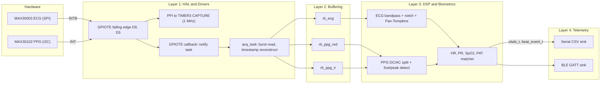

# Ring Cardiovascular Monitor Firmware Plan

PlatformIO + Adafruit nRF52 Arduino firmware for a MAX30003 (ECG, SPI) + MAX30102 (PPG, I2C) health ring. It is built in four decoupled layers (HAL/Drivers, Buffering, DSP/Biometrics, Telemetry) and delivered in four phased milestones. Features: hardware-captured microsecond timestamps, lock-free SPSC ring buffers, Pan-Tompkins HR, PPG PR/SpO2, PAT (foot and peak), and USB-serial + BLE GATT telemetry.

Target hardware: Nordic nRF52840. Prototyping on the Adafruit Feather nRF52840 Express, migrating to a custom PCB with the Fanstel BT840 module (nRF52840-QIAA).

- ECG: Analog Devices MAX30003 on the MAX30003WING board, over SPI (SCK, MOSI, MISO, CS on D10, active-low FIFO interrupt INTB on D9). True 2-lead dry-contact setup with internal common-mode bias. INP goes to the primary ring electrode; INN goes to the secondary contralateral ring electrode via a tether. There is no third body-ground/RLD electrode.
- PPG: Analog Devices MAX30102 over I2C (address 0x57, SCL, SDA, active-low INT on D5), 3.3 V logic with 4.7 kOhm pull-ups.

## 1. Decisions locked in

- Framework: Adafruit nRF52 Arduino core (FreeRTOS + Bluefruit/S140 SoftDevice) built with PlatformIO. GPIOTE/PPI/TIMER are touched at register level only inside the HAL.
- Clock: the MAX30003WING's onboard 32.768 kHz crystal drives FCLK, so the MCU does not generate it. The custom PCB will provide its own oscillator.
- Rates: ECG 256 Hz (`FMSTR=00`, `RATE=01`), PPG 100 Hz. Both are compile-time settings in config.
- Interrupt path: the GPIOTE falling edge latches a 1 MHz TIMER count through PPI (zero software latency). The handler then notifies an acquisition task, which does the burst read and pushes into the ring buffers.
- BLE: standard Heart Rate Service (0x180D), standard Pulse Oximeter Service (0x1822), and a custom service carrying PAT, signal quality, and an optional raw waveform.
- PAT: two variants, R-peak to PPG foot (steepest upslope) and R-peak to systolic peak, both in microseconds.
- ECG chain: 0.5-40 Hz bandpass plus a 60 Hz notch (switchable to 50 Hz). Contact detection uses MAX30003 DC lead-off and the MAX30102 IR DC level.
- SpO2: Maxim quadratic `SpO2 = -45.060 R^2 + 30.354 R + 94.845`, with coefficients in config.
- Testing: the Buffering and DSP layers are Arduino-free and unit-tested on the host (`pio test -e native`, Unity).
- BT840 pins: placeholders mirroring the Feather's physical nRF pins, marked TODO.

## 2. Layered architecture and data flow



Ownership rules that keep the layers decoupled:
- Only `acq_task` touches the SPI and I2C buses. Each bus has a single owner, so no bus mutexes are needed.
- Each ring buffer is strictly single-producer (`acq_task`) and single-consumer (`dsp_task`).
- DSP code takes plain `sample_t` arrays and emits plain structs. It never includes Arduino or nRF headers, which is what makes it host-testable.
- Telemetry sees only `vitals_t` and `beat_event_t` through a `telemetry_sink` interface.

FreeRTOS tasks:
- `acq_task` (highest app priority): woken by interrupt notification bits `ECG_IRQ` and `PPG_IRQ`. It also has a fallback timeout of 2x the expected interrupt interval, so it polls if a line gets stuck low.
- `dsp_task` (medium): woken by `acq_task` after each push. It drains all three buffers in timestamp order and publishes `vitals_t` via `xQueueOverwrite` (a single-slot "latest value" queue). Beat events go into a small queue.
- `telemetry_task` (low): sends vitals at 1 Hz and beat events as they arrive. Raw-waveform streaming is optional and toggled by a flag.

## 3. Project layout

- `platformio.ini`: environments `feather_nrf52840` (`board = adafruit_feather_nrf52840`), `bt840` (custom board, added in Phase 4), and `native` (host tests; ignores the hal, drivers, telemetry, and app libs). `-DFW_PHASE=1..4` selects which phase's `main` runs, so earlier phases remain available as diagnostics.
- `include/board_config.h`: the single source of all pins and bus settings.
- `include/app_config.h`: sample rates, gains, LED current, FIFO thresholds, filter corners, notch frequency, PAT window, SpO2 coefficients, contact thresholds, buffer sizes.
- `lib/hal/`: `hal_spi`, `hal_i2c`, `hal_timestamp` (TIMER3 + PPI), `hal_irq` (GPIOTE attach + PPI hookup), `hal_led` (status blink).
- `lib/drivers/max30003/`: `max30003_regs.h` (addresses and bitfields), `max30003.{h,cpp}`.
- `lib/drivers/max30102/`: `max30102_regs.h`, `max30102.{h,cpp}`.
- `lib/buffering/`: `sample.h` (`typedef struct { uint32_t timestamp_us; int32_t raw_sample; } sample_t;`) and `ring_buffer.{h,c}`.
- `lib/dsp/`: `biquad`, `ecg_filter`, `pan_tompkins`, `ppg_processor`, `spo2`, `pat`, `vitals`, `timestamp_recon`.
- `lib/telemetry/`: `telemetry.h` (interface), `serial_sink`, `ble_sink` (HRS, PLX, custom service).
- `lib/app/`: `acq_task`, `dsp_task`, `telemetry_task`, `phase1.cpp`, `phase2.cpp`.
- `src/main.cpp`: `setup()`/`loop()` that dispatches on `FW_PHASE`.
- `test/`: Unity suites `test_ring_buffer`, `test_biquad`, `test_pan_tompkins`, `test_ppg`, `test_spo2`, `test_pat`, `test_timestamp_recon`.
- `tools/`: `serial_logger.py` (captures CSV to file, used to build real-signal test fixtures) and `plot_serial.py` (live plot, because PlatformIO has no Serial Plotter; Arduino IDE 2's plotter also works on the same port).

## 4. board_config.h design

Selected by `-DBOARD_FEATHER_NRF52840` or `-DBOARD_BT840`. On the Feather, values are Arduino pin numbers. The BT840 variant uses an identity pin map (Arduino pin n = nRF GPIO n, with `NRF_GPIO_PIN_MAP(port, pin)`), so its values are raw P-numbers. The HAL applies them through `SPI.setPins()`, `Wire.setPins()`, and `digitalPinToPinName()`.

```c
#if defined(BOARD_FEATHER_NRF52840)
  #define PIN_ECG_CS     10   // P0.27
  #define PIN_ECG_INTB    9   // P0.26
  #define PIN_PPG_INT     5   // P1.08
  #define PIN_SPI_SCK    SCK  // P0.14
  #define PIN_SPI_MOSI   MOSI // P0.13
  #define PIN_SPI_MISO   MISO // P0.15
  #define PIN_I2C_SDA    SDA  // P0.12
  #define PIN_I2C_SCL    SCL  // P0.11
#elif defined(BOARD_BT840)
  #define PIN_ECG_CS     NRF_GPIO_PIN_MAP(0, 27) // TODO: confirm with PCB
  ...
#endif
#define ECG_SPI_HZ       4000000  // MAX30003 SPI mode 0, max 12 MHz
#define PPG_I2C_HZ       400000
#define PPG_I2C_ADDR     0x57
#define TS_TIMER         NRF_TIMER3
#define TS_PPI_CH_ECG    0        // app range 0-16; S140 reserves 17-31
#define TS_PPI_CH_PPG    1
```

## 5. Phase 1: Bus and silicon sanity check

Build:
- `hal_spi`: `SPISettings(ECG_SPI_HZ, MSBFIRST, SPI_MODE0)` with CS driven manually. The MAX30003 frame is 32 bits: a command byte `(addr << 1) | R/W` (read = 1) followed by 24 data bits.
- `hal_i2c`: `Wire.begin()`, `setClock(400 kHz)`, register read/write, and a chunked burst read of at most 30 bytes per transaction, to stay inside the Wire RX buffer.
- `max30102_read_part_id()` reads 0xFF and expects 0x15. It also logs REV_ID (0xFE).
- `max30003_read_info()` reads 0x0F and expects a non-zero value. It also prints a warning if bits [23:20] are not 0b0101 (the datasheet's fixed pattern), and logs the revision.
- `phase1.cpp`: prints a PASS/FAIL report over Serial. On failure it halts with a distinct LED blink code per device, and also runs an I2C address scan to aid debugging.

Exit criterion: both checks pass across 10 consecutive power cycles.

## 6. Phase 2: Register configuration and polling baseline

MAX30003 init sequence. Every value is built from named bitfields in `max30003_regs.h`:
1. `SW_RST` (0x08) <- 0, then wait.
2. `CNFG_GEN` (0x10): `FMSTR=00` (32768 Hz), `EN_ECG=1`, `EN_RBIAS=01` (ECG bias), `RBIASV=01` (100 MOhm), `RBIASP=1`, `RBIASN=1` (internal common-mode bias for the 2-electrode setup), and `EN_DCLOFF=01` with the lowest practical `DCLOFF_IMAG` (5-10 nA).
3. `CNFG_EMUX` (0x14): `OPENP=0`, `OPENN=0` to connect INP/INN, calibration off, `POL` configurable (the ring can flip lead polarity).
4. `CNFG_ECG` (0x15): `RATE=01` (256 sps), `GAIN=01` (40 V/V default; tune between 20 and 160 from Phase 2 traces), `DHPF=1` (0.5 Hz), `DLPF=01` (40 Hz).
5. `MNGR_INT` (0x04): `EFIT=15`, which interrupts at 16 unread samples. That leaves 16 samples (62 ms) of headroom before the 32-deep FIFO overflows.
6. `EN_INT` (0x02): `EN_EINT`, `EN_EOVF`, `EN_DCLOFFINT`, and `INTB_TYPE=11` (open-drain with internal pull-up). The nRF pull-up is also enabled.
7. `SYNCH` (0x09) <- 0, then `FIFO_RST` (0x0A) <- 0.

FIFO read: burst from `ECG_FIFO_BURST` (0x20). Each word holds the sample in [23:6] (18-bit two's complement, sign-extended to `int32_t`) and the ETAG in [5:3]. The read loop stops on ETAG EOF or empty. ETAG overflow triggers `FIFO_RST` and increments an overflow counter.

MAX30102 init:
1. `MODE_CFG` (0x09) <- 0x40 (reset); poll until the bit clears, then read `INT_STATUS_1` to clear `PWR_RDY`.
2. `FIFO_CFG` (0x08) <- 0x0F: no averaging, rollover off, `A_FULL=15`, so the interrupt fires at 17 samples (170 ms).
3. `SPO2_CFG` (0x0A) <- 0x27: `ADC_RGE=01` (4096 nA), `SR=001` (100 Hz), `LED_PW=11` (411 us, 18-bit).
4. `LED1_PA` (0x0C, Red) = `LED2_PA` (0x0D, IR) <- 0x24 (7.2 mA at 0.2 mA/LSB).
5. `INT_ENABLE_1` (0x02) <- 0x80 (`A_FULL_EN`). Clear the FIFO pointers (0x04-0x06). `MODE_CFG` <- 0x03 (SpO2 mode).

FIFO read: count = `(WR_PTR - RD_PTR) & 0x1F`, and `OVF_COUNTER` is checked. Each sample is 6 bytes, Red then IR, masked to 18 bits (`0x3FFFF`).

Polling baseline (`phase2.cpp`): every 10 ms, drain both FIFOs, timestamped with `micros()` at read time (coarse; Phase 3 replaces this). Each ECG sample emits one line `timestamp,ecg,red,ir`, using the most recent PPG value held. At 256 lines/s of about 32 bytes, that is about 8 KB/s, which fits 115200 baud. A `CSV_PLOTTER_MODE` flag drops the timestamp column so the plotter autoscale isn't dominated by the timestamp ramp.

Exit criterion: a visible QRS on the ECG trace and a pulsatile Red/IR trace. Also confirm that the logged ECG rate is about 256 Hz and the PPG rate about 100 Hz, and choose the ECG gain from the captured traces.

## 7. Phase 3: GPIOTE interrupts, hardware timestamps, ring buffers

Hardware timestamping (`hal_timestamp`, `hal_irq`):
- TIMER3 runs in 32-bit mode at 1 MHz (`PRESCALER=4`) and free-runs. Wrap-around after about 71 minutes is handled with unsigned subtraction.
- `attachInterrupt(pin, cb, FALLING)` lets the core allocate a GPIOTE channel. The HAL then finds that channel by scanning `NRF_GPIOTE->CONFIG[i].PSEL` and wires `EVENTS_IN[ch]` through a PPI channel to `TIMER3->TASKS_CAPTURE[n]`, with CC[0] for ECG and CC[1] for PPG. When the S140 SoftDevice is enabled (Phase 4), the HAL uses `sd_ppi_channel_assign` and `sd_ppi_channel_enable_set` instead of writing PPI registers directly.
- The callback reads the captured CC value as the edge time, stores it, and calls `vTaskNotifyGiveFromISR`/`xTaskNotifyFromISR` with the IRQ bit. No bus I/O happens in interrupt context.
- At start-up and after every read, the task checks the pin level. If the line is still low, it reads again so a missed edge cannot stall the stream. Reading `STATUS` (MAX30003) or `INT_STATUS_1` (MAX30102) de-asserts the line.

Per-sample timestamp reconstruction (`dsp/timestamp_recon`, host-testable):
- The edge fires when sample `k = threshold` lands, so `t_i = t_edge + (i - k) * Ts_est - AFE_LATENCY_US`.
- `Ts_est` is tracked from consecutive edges as `(t_edge_n - t_edge_n-1) / samples_between`, smoothed with an EMA. This absorbs the drift between the MAX30003 crystal and the MAX30102's internal oscillator, which matters because PAT compares the two time bases.
- `ECG_AFE_LATENCY_US` and `PPG_AFE_LATENCY_US` are constants in `app_config.h`. The ECG value comes from the MAX30003 datasheet latency table for 256 sps with the 40 Hz DLPF, filled in during Phase 3.

Lock-free SPSC ring buffer (`lib/buffering`):
- Power-of-two capacity, with `volatile uint32_t head` (written only by the producer) and `tail` (written only by the consumer). A `__DMB()` sits between the data write and the head publish, and between the data read and the tail publish.
- When full, the producer drops the newest sample and increments `overflow_count`, because it must never touch `tail`.
- API: `rb_init`, `rb_push`, `rb_pop`, `rb_pop_bulk`, `rb_count`, `rb_overflows`.
- Sizes: `rb_ecg` holds 1024 entries (4 s, 8 KB); `rb_ppg_red` and `rb_ppg_ir` hold 512 each (5 s, 4 KB each).

Phase 3 verification ("no packet loss"):
- A stats line every 5 s reports samples/s per stream, ring-buffer overflows, MAX30003 ETAG overflows, MAX30102 `OVF_COUNTER`, gaps (any reconstructed `dt > 1.5 Ts`), and the latency from edge to start of the burst read.
- Exit criterion: a 30-minute run with zero overflows and zero gaps, and output identical in format to Phase 2. The CSV consumer reads from the ring buffers.

## 8. Phase 4: DSP pipeline, biometrics, telemetry, board abstraction

DSP building blocks. Everything is float, using the Cortex-M4F FPU, and coefficients are computed at init from `fs` and `fc` (RBJ biquad formulas), so changing a sample rate needs no regenerated tables.
- `biquad`: Direct Form II transposed cascade. Each filter exposes its group delay in samples at band center, for PAT compensation.
- `ecg_filter`: 2nd-order Butterworth HPF at 0.5 Hz, 4th-order LPF at 40 Hz, and a 60/50 Hz notch (Q of about 30). The software bandpass can be disabled by a flag, since the on-chip DHPF/DLPF already cover most of it.
- `pan_tompkins` (adapted to 256 Hz): 5-15 Hz bandpass, 5-point derivative, squaring, 150 ms moving-window integration (38 samples), adaptive SPKI/NPKI thresholds, a 200 ms refractory period, T-wave rejection below 360 ms via slope comparison, and searchback at 1.66x the average RR. The R-peak is then refined on the 0.5-40 Hz signal (largest absolute value within +/-50 ms after delay compensation, plus parabolic sub-sample interpolation) and output as `r_peak_t_us`. Polarity is auto-detected from the sign of the first learned peaks.
- `ppg_processor` (one instance each for Red and IR): DC from a 1st-order low-pass at about 0.3 Hz. AC from a 0.5-5 Hz bandpass applied to the inverted signal (more blood means less reflected light, so systole is a dip in raw counts). Systolic peak detection uses an adaptive threshold with a 300 ms refractory period. The foot is the maximum of the first derivative between the preceding trough and the peak. Both fiducials get parabolic interpolation and group-delay compensation. Each beat yields `{t_foot_us, t_peak_us, ac_pp, dc}`.
- `spo2`: per beat, `R = (AC_red/DC_red)/(AC_ir/DC_ir)`. Output is the median over the last 8 beats, mapped through the configurable quadratic and clamped to 70-100 %.
- `vitals`: HR = 60e6 / median RR over the last 8 beats; PR is the same from PPG peak intervals.
- `pat`: keeps the last 4 R-peaks. For each PPG beat, it matches the latest R-peak inside `[PAT_MIN_US, PAT_MAX_US]` (default 100-600 ms) and emits `pat_foot_us` and `pat_peak_us`. Values more than 3 MAD (median absolute deviation) from the recent median are rejected as outliers.
- Signal quality: `FLAG_ECG_CONTACT` comes from the MAX30003 `LDOFF_*` status bits; `FLAG_PPG_FINGER` means IR DC is above `PPG_FINGER_DC_MIN`. A 3 s or 3-beat warm-up runs after contact is acquired. The HR/SpO2/PAT valid flags are cleared whenever contact is lost.

```c
typedef struct {
  uint32_t timestamp_us;
  float hr_bpm, pr_bpm, spo2_pct, r_ratio;
  uint32_t pat_foot_us, pat_peak_us;
  uint8_t flags; // ECG_CONTACT, PPG_FINGER, HR_VALID, PR_VALID, SPO2_VALID, PAT_VALID
} vitals_t;
```

Telemetry (`lib/telemetry`):
- The `telemetry_sink` interface has `begin()`, `publish_vitals()`, `publish_beat()`, and `publish_raw()`. A fan-out sends to every registered sink.
- `serial_sink`: a CSV vitals line at 1 Hz, with the Phase 2 raw CSV kept as a selectable mode.
- `ble_sink` (Bluefruit):
  - HRS 0x180D: Heart Rate Measurement 0x2A37 (notify) and Body Sensor Location 0x2A38.
  - PLX 0x1822: PLX Continuous Measurement 0x2A5F (notify, SFLOAT SpO2 and PR) and PLX Features 0x2A60.
  - Custom 128-bit service: a PAT/beat characteristic (notify, packed struct of beat time, PAT foot, PAT peak, flags), a status characteristic (contact flags and overflow counters), and an optional raw-waveform characteristic (notify; requests a larger MTU and 2M PHY; off by default).
  - `Bluefruit.begin()` runs before the timestamp HAL init, so PPI setup goes through the SoftDevice API.

Board abstraction:
- Finalize `include/board_config.h` and grep-verify that no pin number or peripheral instance appears outside it.
- Add `boards/bt840.json` and `variants/bt840/variant.{h,cpp}` (identity pin map, LF clock source setting, USB). Document flashing the Adafruit UF2 bootloader onto the BT840 over SWD (J-Link or nRF52-DK).

Exit criteria:
- Host tests pass.
- On the Feather, HR within +/-3 bpm of a reference pulse oximeter or chest-strap HR.
- PR agrees with HR.
- SpO2 is plausible (95-100 % at rest) until calibrated.
- PAT is stable within about +/-10 ms beat to beat at rest.
- nRF Connect on a phone shows live HR and SpO2.

## 9. Host test strategy (`pio test -e native`)

- Ring buffer: empty and full edge cases, wrap at 2^32 indices, ordering, and overflow counting.
- Biquad: measured gain at 10 Hz passes, 60 Hz is attenuated by more than 30 dB, 0.1 Hz is attenuated, and the reported group delay matches measurement.
- Pan-Tompkins: synthetic ECG (Gaussian QRS at known times, with baseline wander, 60 Hz, and noise) must reach at least 99 % sensitivity and positive predictive value, with timing error of at most 1 sample. Fixtures recorded with `tools/serial_logger.py` are added later.
- PPG and PAT: synthetic PPG delayed a known 250 ms from the synthetic ECG must give PAT within +/-4 ms.
- SpO2: synthetic AC/DC ratios must reproduce the expected R and SpO2.
- Timestamp reconstruction: a simulated 1 % oscillator drift must stay within 1 sample after 60 s.

## 10. Out of scope for this plan

Low-power operation (the 1 MHz TIMER keeps the high-frequency clock running; an RTC-based 30.5 us alternative can come later), battery and fuel gauge, OTA updates, flash logging, a phone app, and clinical calibration of SpO2.

## 11. Implementation checklist

- [ ] Scaffold PlatformIO project (git init, `platformio.ini` with feather/native envs, folder layout, `board_config.h`, `app_config.h`, `FW_PHASE` dispatch)
- [ ] Phase 1: `hal_spi`, `hal_i2c` (chunked), MAX30003/MAX30102 register headers, PART_ID and INFO checks, PASS/FAIL report + LED codes
- [ ] Phase 2: soft-reset + full register init for both ICs, FIFO burst readers (ETAG / WR-RD pointer), polling CSV streamer, Python logger/plotter
- [ ] Phase 3: lock-free SPSC ring buffer + host tests
- [ ] Phase 3: TIMER3 1 MHz + GPIOTE-to-PPI capture, ISR task notification, `acq_task`, timestamp reconstruction with drift tracking, stuck-line recovery, stats/no-loss verification
- [ ] Phase 4: biquad lib, ECG filter + notch, Pan-Tompkins with R refinement, PPG processor (DC/AC, foot, peak), SpO2, HR/PR, PAT matcher, contact flags + host tests
- [ ] Phase 4: `telemetry_sink` interface, serial sink, BLE sink (HRS 0x180D, PLX 0x1822, custom PAT/status/raw service)
- [ ] Phase 4: finalize `board_config.h` abstraction, BT840 board JSON + identity-map variant, bootloader/flash notes
